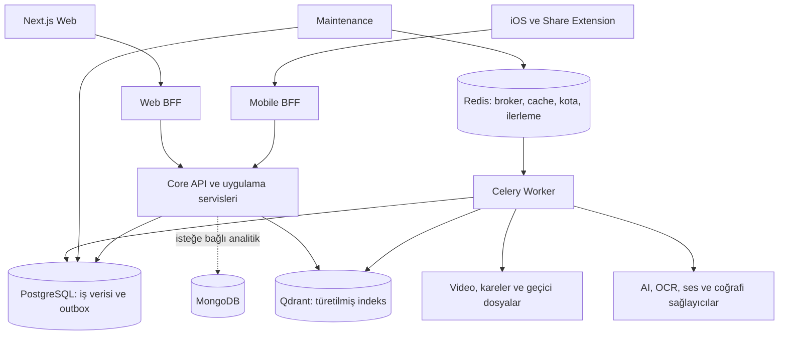
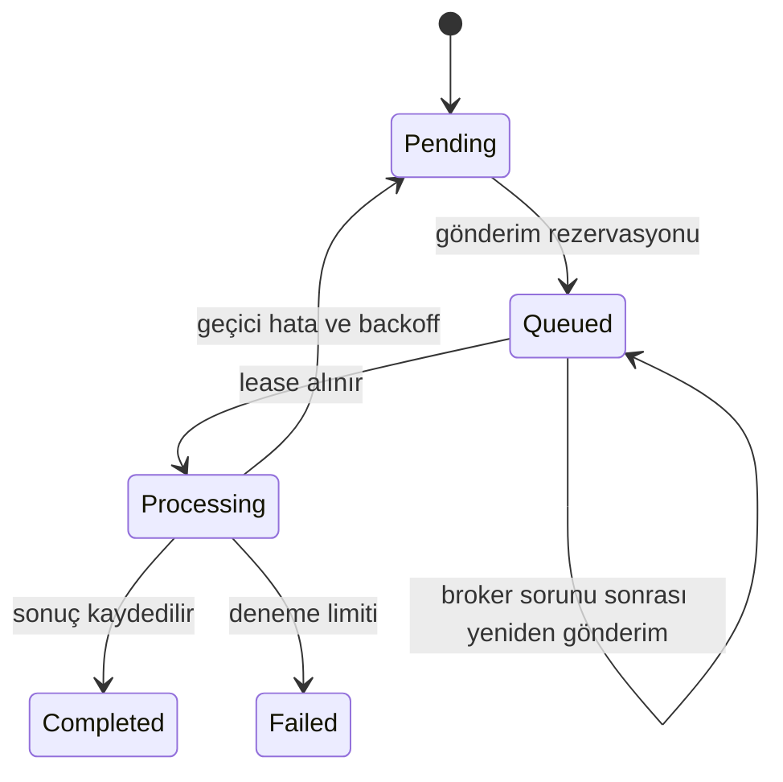

# TripClip AI — Uçtan Uca Yazılım Mühendisliği İncelemesi

**Tarih:** 21 Ekim 2026

**İncelenen kod:** `cd4540d`

**Amaç:** Bir aylık pazara çıkış çalışmasını teknik kanıta dayandırmak ve kararların mühendislik gerekçesini öğrenmek.

**Kapsam:** Core API, iki BFF, AI/geocoding/RAG, PostgreSQL ve iş kuyruğu, web, iOS/Share Extension, testler, CI, dağıtım ve veri yaşam döngüsü.

> **Ana değerlendirme:** Proje, basit bir demo aşamasını geçmiş; anlamlı katmanları ve toparlanabilir iş akışları olan çalışan bir ürün temeline sahip. Ancak yeşil testler tek başına pazar hazırlığını kanıtlamıyor. Öncelikli kalan konular iOS hesaplar arası yerel veri ayrımı, oturum bilgilerinin saklanması, türetilmiş medya temizliği, URL indirme sınırları ve gerçek işletim kanıtı.

## İçindekiler

1. [Raporu nasıl okumalı?](#1-raporu-nasıl-okumalı)
2. [Ürün sözleşmesi ve kapsam](#2-ürün-sözleşmesi-ve-kapsam)
3. [Mimari haritası](#3-mimari-haritası)
4. [Prensipler üzerinden mevcut durum](#4-prensipler-üzerinden-mevcut-durum)
5. [İyi tasarlanmış parçalar](#5-iyi-tasarlanmış-parçalar)
6. [Öncelikli bulgular](#6-öncelikli-bulgular)
7. [AI, analiz ve RAG değerlendirmesi](#7-ai-analiz-ve-rag-değerlendirmesi)
8. [Web ve iOS deneyimi](#8-web-ve-ios-deneyimi)
9. [Veri modeli ve tutarlılık](#9-veri-modeli-ve-tutarlılık)
10. [Performans, maliyet ve işletim](#10-performans-maliyet-ve-işletim)
11. [Test kanıtı ve sınırları](#11-test-kanıtı-ve-sınırları)
12. [Bir aylık uygulama sırası](#12-bir-aylık-uygulama-sırası)
13. [Yayın kabul listesi](#13-yayın-kabul-listesi)
14. [Öğrenme rehberi ve sözlük](#14-öğrenme-rehberi-ve-sözlük)
15. [Kaynak kod indeksi](#15-kaynak-kod-indeksi)

## 1. Raporu nasıl okumalı?

Bu, seçilen kritik kod yollarını uçtan uca izleyen bir mühendislik incelemesidir; her satırın resmi denetimi veya sızma testi değildir. Rapor hazırlanırken ürün kodu değiştirilmedi. Docker başlatılmadı, mevcut hesaplar/analizler değiştirilmedi, gerçek video yeniden gönderilmedi.

Üç kanıt türü kullanıyorum:

| İşaret | Anlamı |
|---|---|
| **K — Kod kanıtı** | İlgili uygulama yolu kaynakta görüldü; riskin gerçek kullanıcıda gerçekleştiği anlamına gelmez. |
| **D — Deneme kanıtı** | Küçük ve kontrollü bir yerel denemeyle davranış yeniden üretildi. |
| **B — Bekleyen doğrulama** | Dağıtım, cihaz, yük veya dış sağlayıcı ortamında henüz sınanmadı. |

Öncelikler: **P1** kontrollü yayın öncesinde kapatılmalı; **P2** yayın riski/kapsamıyla birlikte planlanmalı; **P3** bakım ve verim iyileştirmesi. Bunlar CVSS puanı veya hukuki değerlendirme değildir. Bu inceleme bir P0 olay kanıtlamadı; bu, hiç P0 bulunmadığı garantisi değildir.

Eski raporlar tarihsel kayıttır. Önceki açığın bugünkü kodda kapanmış olması ile aynı alanın tamamen güvenli olması farklı şeylerdir.

## 2. Ürün sözleşmesi ve kapsam

Önerilen ilk sürüm vaadi: **“Gezi videosunu paylaş, içindeki yerleri keşfet, kendi gezi planını oluştur.”**

Bu vaat şu davranışlara bölünmeli:

| Kullanıcı beklentisi | Sistem karşılığı | Yanlış güven oluşturmayan davranış |
|---|---|---|
| Videom kaybolmasın | Video ve analiz işi birlikte kaydolur | Kabul edilen işin kimliği ve durumu görünür |
| Yerleri bulsun | Ad çıkarımı, coğrafi çözümleme, son doğrulama | Bulunamayan yer ayrı listelenir |
| Beni doğru yere götürsün | Kimliği ve bağlamı uyumlu konum | Yaklaşık/çözülemeyen pin rotaya alınmaz |
| Gezi hazırlasın | Library, Trip, optimizer | Yol süresi tahmininin niteliği açıklanır |
| Bilgi versin | Genel öneri veya kaynaklı retrieval | Kaynaklı bilgiyle model bilgisi ayrılır |
| Hesabım güvende olsun | Auth, sahiplik ve cihaz içi izolasyon | Başka hesaba ait yerel cache de gösterilmez |

İlk sürümde desteklenen platform ve içerik türleri açıkça yazılmalı. Kodun URL kabul listesi Instagram/YouTube içeriyor; bu, her Instagram postunun, fotoğraf slaytının veya her indirmenin desteklendiği anlamına gelmez. TikTok fotoğraf desteğini ilk sürüme eklemek mevcut güvenilirlik işlerinden bağımsız yeni kapsamdır.

**Öğrenme:** Bir özellik yalnızca başarılı ekran değildir. Girdi sınırları, başarısızlık, iptal, erişim, tekrar deneme ve veri silme davranışı da özellik sözleşmesine dahildir.

## 3. Mimari haritası

### 3.1 Katmanların sorumluluğu

| Katman | İyi sınır | Sınır bozulursa ne olur? |
|---|---|---|
| Web/iOS | Sunum, etkileşim, yerel durum | İş kuralı iki istemcide farklılaşır |
| BFF | Kimlik taşıma, istemciye uygun sözleşme | Her BFF ayrı ürün kuralı uygular |
| Application service | Kullanım senaryosu ve işlem sırası | Route'lar büyür, hata yolları dağılır |
| Domain | Planlama modelleri, strateji ve kurallar | Framework değişimi iş kuralını bozar |
| Repository | Kalıcılık, kilit ve sorgular | Transaction sınırı belirsizleşir |
| Provider adaptörü | Dış servis protokolü | İş akışı sağlayıcı formatına kilitlenir |

Mevcut yapı katmanlı bir Core ve istemciye özel BFF'ler olarak anlamlı. Bunu bütünüyle “tam Clean Architecture” diye etiketlemek doğru olmaz: uygulama servisleri FastAPI hatalarını, ORM modellerini veya altyapı servislerini doğrudan tanıyabiliyor. Bu küçük ekip için yönetilebilir bir tercih; fakat bağımlılık sınırları belgelenmeli.

Bu aşamada yeni mikroservis çıkarmak yerine Core içindeki modülleri güçlendirmek daha düşük riskli. Deploy edilen servis sayısının artması otomatik olarak daha iyi mimari oluşturmaz.

### 3.2 Analiz kabulünden sonuca

1. BFF kimliği doğrular ve upload sınırını uygular.
2. Core dosyayı yazar; video ve `video_analysis` işi SQL'e kaydedilir.
3. Maintenance bekleyen işi broker'a gönderir.
4. Worker lease ve analiz kilidi altında işlem yapar.
5. Yer adayları çıkarılır; kendi bölgesinde aranır ve son doğrulama kapısından geçer.
6. Video sonucu ile `travel_tips` ve `library_sync` niyetleri kaydolur.
7. Ana sonuç görülebilir; yan işler daha sonra tamamlanabilir.

Bu şema job durumları içindir. Video durumuyla, öneri durumuyla ve Library durumuyla aynı kavram değildir.

## 4. Prensipler üzerinden mevcut durum

| Prensip | Mevcut kanıt | Sonraki geliştirme |
|---|---|---|
| Sorumluluk ayrımı | BFF/Core, provider ve repository ayrımı | Büyük geocoding ve istemci API dosyalarını sorumluluklarına ayırmak |
| Bağımlılıkların ters çevrilmesi | Repository/AIProvider/optimizer arayüzleri | Framework ve ORM bağımlılıklarının kullanım senaryolarına yayılmasını azaltmak |
| Tek doğruluk kaynağı | SQL ana veri, ortak görünür yer hesabı | BFF/iOS/web kalite alanlarını aynı sözleşmeye bağlamak |
| Atomicity | Video ile outbox aynı commit | Refresh rotation'ın birden çok commit'ini incelemek |
| Idempotency | Lease, analiz kilidi, kullanıcı-yer unique constraint | Global Place oluşturmayı da eşzamanlı güvenli yapmak |
| En az yetki | Sahiplik kontrolleri ve public yayın kararı | Cihaz cache'ini de hesap sınırına dahil etmek |
| Hata toleransı | Sağlayıcı fallback, bounded retry | Timeout'un çalışan işi gerçekten sonlandırıp sonlandırmadığını ölçmek |
| Gözlemlenebilirlik | Metrik, request log, job durumları | Ölçümlerin alarm ve müdahale prosedürüne bağlanması |
| Tekrarlanabilirlik | CI ve geçici test DB | ML transitif bağımlılıklarının ve model sürümlerinin sabitlenmesi |
| Kullanıcı güveni | Unresolved bölüm, yaklaşık rota ifadesi | Genel model bilgisi ve kaynaklı cevabın tüm ekranlarda ayrılması |

SOLID ilkelerini “her sınıfa arayüz yazmak” olarak uygulamamalıyız. En değerli arayüz, bağımsız değişen veya testte değiştirmemiz gereken sınırdır: AI sağlayıcısı, veri deposu, rota stratejisi gibi.

## 5. İyi tasarlanmış parçalar

### 5.1 Transactional outbox ve toparlanma

`deferred_work.py` işi SQL'de saklıyor, atomik lease alıyor, sınırlı tekrar deniyor ve eski tamamlanmış işleri temizliyor. Video tamamlanırken Library senkronizasyonunun da kayda girmesi, “video var ama yapılacak iş unutuldu” riskini azaltıyor. [S01], [S02]

PostgreSQL advisory lock aynı video üzerinde pahalı analizin yinelenmesini sınırlıyor. SQLite bu kilidin karşılığı değildir; kilit davranışını PostgreSQL entegrasyon testleri kanıtlamalı. [S03]

**Önemli ayrım:** Bu yapı “dış AI çağrısı kesinlikle bir kez yapılır” garantisi vermez. Dış çağrıdan sonra SQL commit'inden önce çökme olursa yeniden çağrı ihtimali vardır. Doğru ifade: tekrar teslimata dayanıklı işleme ve idempotent sonuç yönetimi.

### 5.2 Public veri ve sahiplik ayrımı

`VideoService.get_video_detail` sahibi dışındaki erişimde tamamlanmış olmayı yeterli görmüyor; ayrıca açık public yayın kararı arıyor. 404 kullanımı kaydın varlığını gizleyen bilinçli tercih. Asistan da retrieval/provider öncesinde Trip erişimini çözüyor. [S04], [S05]

### 5.3 Üretimde güvenli başlangıç

Internal secret kontrolü sabit zamanlı karşılaştırma kullanıyor. Production migration hatası startup'ı durduruyor; PostgreSQL migration işlemleri advisory lock ile serileştiriliyor. Eski açıklama “startup bloklamaz” dese de güncel production kodu fail-closed çalışıyor. [S06], [S07]

### 5.4 AI ile deterministik planlama ayrılmış

Rota/itinerary stratejileri domain arayüzü altında. LLM'in serbest metnini doğrudan gezi mutasyonuna dönüştürmek yerine kısıtlı ve doğrulanan araçlar kullanılması iyi bir sınır. Apply/undo yollarında Trip satır kilitleri bulunuyor. [S05], [S08]

### 5.5 Test altyapısı anlamlı hale gelmiş

Core pytest süreçleri artık ayrı geçici SQLite dosyası kullanıyor; gerçek kullanıcı veritabanı seçilmiyor. Entegrasyon testleri ayrıca açık opt-in ve `tripclip_integration` veritabanı adı kontrolü istiyor. CI'da iOS, backend, web, container build ve altyapı dayanıklılık işleri var. Bunlar olumlu mühendislik yatırımları. [S09], [S10]

## 6. Öncelikli bulgular

### F01 — iOS yerel geçmişi hesap bazında ayrılmıyor

**Öncelik:** P1 · **Kanıt:** K · **Alan:** gizlilik ve istemci veri modeli.

`PersistenceController.save` kaydı yalnızca `videoId` ile buluyor; `fetchAll` hesap filtresi taşımıyor. `HistoryView` bütün SavedVideo kayıtlarını çekiyor. AuthEnvironment logout/delete sırasında token ve App Group'u temizliyor; incelenen yollarda CoreData `deleteAll()` çağrısı yok. [S11], [S12]

**Etki:** Aynı cihazda A hesabının kayıtları B hesabına geçildiğinde yerel geçmişten gösterilebilir. Sunucudaki sahiplik kontrolü, önceden cache'lenmiş ekranı korumaz. Gerçek cihazda hesap değiştirerek yeniden üretim henüz yapılmadı; kod yolları bu izolasyon boşluğunu gösteriyor.

**Çözüm:** Cache anahtarını `(userID, videoID)` yap; bütün sorguları kullanıcı kapsamına al. Logout/delete için temizleme politikası belirle. Eski cache migration'ında sahibi bilinmeyen kayıtları başka kullanıcıya göstermeme yönünde güvenli davran.

**Kabul testi:** A ile kaydet → logout → B ile giriş → online/offline geçmiş ve doğrudan sonuç açma yollarında A verisi görünmemeli. Sunucu silme sonrası çevrimdışı cache'in davranışı da tanımlı olmalı.

**İlke:** Yetkilendirme sınırı ağda bitmez; cihazdaki her veri kopyasını kapsar.

### F02 — Keychain kullanımı, App Group'a token kopyalanmasıyla zayıflıyor

**Öncelik:** P1 · **Kanıt:** K · **Alan:** oturum saklama.

AuthEnvironment hem access hem refresh token'ı Keychain'e ve AppGroupStore'a yazıyor. AppGroupStore/BackgroundUploader bu değerleri UserDefaults üzerinden paylaşıyor. [S12], [S13]

**Etki:** “Token'lar yalnızca Keychain'de” güvenlik iddiası doğru değil. App Group sandbox'ı koruma sağlar; ancak UserDefaults sır saklamak için Keychain ile aynı güvenlik sınırını sunmaz. Bu bulgu token'ların herkese açık olduğu anlamına gelmez.

**Çözüm:** Ana uygulama ve extension için uygun erişim grubuyla ortak Keychain kullan; App Group'ta yalnızca sır olmayan bekleyen iş bilgisi tut. Keychain yazım hatasını kullanıcı oturumu açısından ele al. Eski UserDefaults token'larını kontrollü migration ile temizle.

**Kabul testi:** Login/refresh sonrası paylaşılan preferences içinde token bulunmamalı; gerçek cihaz extension'ı doğru Keychain grubuyla yükleme yapmalı; logout sonrası ikisi de erişememeli.

**İlke:** Güvenlik en güçlü kopyaya değil, en zayıf kopyaya bağlıdır.

### F03 — Türetilmiş medya için temizlik kapsamı eksik

**Öncelik:** P1 · **Kanıt:** K · **Alan:** veri yaşam döngüsü ve disk.

Video işlemcisi `/app/uploads/frames/<video_id>` altında kareler ve thumbnail oluşturuyor. Retention kodu `Video.file_path` ile PendingFileErasure yollarını temizliyor; root'u video upload dizini. Hesap silme de video dosya yollarını kuyruğa alıyor. İncelenen kodda frame dizinini temizleyen eşdeğer yol bulunamadı. [S14], [S15]

**Etki:** Ham videonun silinmesi, ondan türetilmiş görüntülerin de silindiği anlamına gelmeyebilir. Bu hem gizlilik hem disk dolması riski. Dosyaların dışarıdan erişilebilir olduğu veya ihlal gerçekleştiği kanıtlanmadı.

**Çözüm:** Medya manifesti/varlık envanteri oluştur; video, kare, ses, thumbnail ve geçici upload body için sahiplik ve TTL tanımla. Başarılı/başarısız analiz ve hesap silme bu envantere aynı silme işini yazmalı. Sahipsiz dizinler için kontrollü sweep ekle.

**Kabul testi:** Analiz, başarısızlık ve hesap silme sonrası bütün türevler izole dosya sisteminde denetlensin. Worker tam ortada kapanınca temizlik tamamlanabilsin; başka kullanıcı dizini silinmesin.

**İlke:** Silme bir endpoint değil, bütün kopyaları kapsayan yaşam döngüsüdür.

### F04 — URL indirmesi, normal upload sınırlarıyla aynı korumaya sahip değil

**Öncelik:** P1 · **Kanıt:** K/B · **Alan:** kaynak tüketimi ve dış ağ.

URL kabulünde gerçek host ayrıştırılması ve allowlist var; eski substring kontrolünden daha güvenli. Ancak `_download_url` seçeneklerinde açık `max_filesize`, `noplaylist`, bağlantı deneme bütçesi veya medya süre sınırı görünmüyor. Upload'ın 100/200 MB sınırı bu indirme yoluna uygulanmıyor. [S16], [S17]

**Etki:** Uzun/büyük veya çok öğeli içerik worker diski ve işlem bütçesini zorlayabilir. İzinli ilk host, indiricinin sonraki bütün redirect/CDN bağlantılarının güvenli olduğunu tek başına kanıtlamaz. Bu incelemede SSRF istismarı veya aktif ağ testi yapılmadı.

**Çözüm:** İlk sürümde tek medya, süre, gerçek indirilen byte, disk ve toplam zaman bütçesi tanımla. Boyut metadata'sı eksikken de byte sayacı durdurabilsin. Worker egress politikasını redirect/CDN ve özel IP riskine göre tasarla; yalnızca başlangıç URL regex'ine güvenme.

**Kabul testi:** Kontrollü sahte indiriciyle büyük dosya, metadata'sız akış, playlist ve redirect durumları; tamamlanmayan indirmede kısmi dosya temizliği. Gerçek platform denemesi ayrı izinli entegrasyon testi olmalı.

**İlke:** Kullanıcıdan gelen URL, sunucunun yapacağı ağ işlemi için sınırlı bir talep olmalıdır.

### F05 — Refresh rotation birden fazla commit'e bölünüyor

**Öncelik:** P2 · **Kanıt:** K · **Alan:** transaction ve oturum kullanılabilirliği.

AuthService önce `revoke_if_active` çağırıyor; repository bunu commit ediyor. `_issue_tokens` yeni refresh satırını başka commit ile oluşturuyor ve replaced-by bağlantısını ayrıca güncelliyor. [S18], [S19]

**Etki:** Eski token iptal edildikten sonra yeni token kaydı yazılamazsa kullanıcı yenileme hakkını kaybeder. Yanıtın kaybolması ve eşzamanlı replay de ayrı test gerektirir. Atomik claim olması, rotation'ın bütününün atomik olduğu anlamına gelmez.

**Çözüm:** Eski satır claim'i, yeni satır ve ilişki tek Unit of Work içinde commit edilmeli. Başarılı commit sonrası yanıt kaybı için güvenlik/kullanılabilirlik politikası ayrıca tanımlanmalı; basitçe replay kontrolünü kaldırma.

**Kabul testi:** Claim sonrası insert hatası enjekte et; transaction rollback sonrası eski token durumunu kontrol et. İki eşzamanlı refresh için yalnızca tanımlanan sonuçlar oluşsun. Web çoklu sekme ve iOS app/extension birlikte test edilsin.

**İlke:** Transaction sınırı repository metoduna göre değil, iş kararının bütününe göre seçilir.

### F06 — Konum doğrulama bir çelişki filtresi; doğru yer kimliği garantisi değil

**Öncelik:** P2 · **Kanıt:** K/D · **Alan:** AI kalite ve domain doğruluğu.

Son ortak kapı artık mevcut; önceki kapsam açığı kapatıldı. Ancak ad kontrolü ortak ayırt edici kelime görünce geçebiliyor ve beklenen yer türünü karşılaştırmıyor. Yerel denemede `Efes Antik Kenti` sorgusu için Selçuk bağlamındaki `Efes Market` adını reddetmedi. Bu sentetik tanısal örnektir; canlı sonuçta böyle bir eşleşme gördüğümüz iddia edilmiyor. [S20]

`_fold` ASCII dışı yazıları siliyor: `東京` için boş metin üretildi. Türkiye odaklı ilk sürümde bu kapsam sınırı belgelenebilir; dünya çapında doğruluk iddiasında ise düzeltilmeli.

**Çözüm:** Beklenen kategori/yer türünü extraction'dan taşı; isim token örtüşmesini tek kriter yapma. Kalıcı OSM/provider kimliği, adres hiyerarşisi, alias ve kategori uyumunu birlikte değerlendir. `unresolved`, `candidate`, `matched` ile bağımsız doğrulanmış bilgiyi birbirine karıştırma.

**Kabul testi:** Aynı kökü taşıyan market/tarihi alan, aynı isimli farklı ilçeler, Türkçe varyantlar ve desteklenecek alfabeler. Yanlış pini reddetme oranı kadar doğru pini gereksiz reddetme oranı da ölçülsün.

**İlke:** “Çelişki bulamadım”, “doğru olduğunu kanıtladım” demek değildir.

### F07 — Aşama timeout'u toplam beklemeyi kesmeyebiliyor

**Öncelik:** P2 · **Kanıt:** K/D · **Alan:** eşzamanlılık ve gecikme.

`run_parallel`, `ThreadPoolExecutor` context manager içinde future timeout'u yakalıyor. `future.cancel()` başlamış thread'i durdurmuyor; context'ten çıkış da çalışan işleri bekliyor. Yerel tanıda 0.01 saniye sınırı olan 0.12 saniyelik görev yaklaşık 0.12 saniyede döndü. Celery hard limit dış sınır olarak duruyor; aşama sınırıyla aynı şey değil. [S21]

**Çözüm:** HTTP ve medya subprocess'lerinde gerçek timeout; iptal edilebilir iş; gerekirse süreç izolasyonu. Executor'ı yalnızca `wait=False` yapmak da tek başına kaynak tüketimini bitirmez. Retry sırasında eski işi çalışır bırakma.

**Kabul testi:** Takılan sağlayıcıya rağmen toplam süre, canlı thread/process sayısı ve art arda videolarda bellek ölçülsün. Celery hard kill sonrası job lease toparlanması ayrı doğrulansın.

**İlke:** Beklemeyi bırakmak, işi durdurmak değildir.

### F08 — Platformlar arasında konum kalitesi ve öneri durumu sözleşmesi farklı

**Öncelik:** P2 · **Kanıt:** K · **Alan:** API ve ürün tutarlılığı.

Mobil transformer precision üretiyor ama Swift `LocationPin` bunu modellemiyor. Web `_web_locations` precision/validation bilgisini düşürüyor. Aktif web sonuç ekranı ham detay yolunu kullanabildiği için bu, bütün web payload'larının kalite bilgisini kaybettiği anlamına gelmez; sözleşmeler farklılaşıyor. Mobil `PlanDetail` da sunucudaki öneri job durumunu ayrı alan olarak kullanmıyor; iOS boş sonuç ve yoklama süresi üzerinden karar veriyor. [S22], [S23]

**Çözüm:** Ortak örnek payload'lar: eşleşen, bulunamayan, eski kayıt, öneri pending/failed/unavailable. BFF'ler bunları istemciye uygun adlarla ama aynı anlamla taşımalı. Swift/TypeScript modelleri kaliteyi gerçekten tüketmeli.

**Kabul testi:** Aynı analiz web ve iOS'ta aynı eşleşen/bulunamayan sayısını, kalite anlamını ve öneri durumunu göstermeli. Eski kayıtta alan eksikliği “kesin doğru” varsayımına dönüşmemeli.

**İlke:** Ortak backend kullanmak, ortak ürün sözleşmesini kendiliğinden sağlamaz.

### F09 — Global Place kimliği ve sayaç eşzamanlılığı yeterince güçlü değil

**Öncelik:** P2 · **Kanıt:** K/B · **Alan:** veri bütünlüğü.

Place eşleştirmesi isim anahtarıyla aday okuma ve mesafe hesabından sonra insert yapıyor. Place modelinde bilinçli olarak bu global kimlik için unique constraint yok. PlaceSave'de kullanıcı/yer uniqueness var; ancak önce iki ayrı global Place oluşursa bu constraint onları birleştiremez. Sayaç artışı `save_count + 1` şeklinde okunup yazılıyor. [S24]

**Etki:** Eşzamanlı farklı video/kullanıcı işleri aynı yer için çift Place veya kayıp sayaç güncellemesi oluşturabilir. Ardışık tekrar testi bu yarışın kanıtı değildir; canlıda yarış yeniden üretilmedi.

**Çözüm:** Provider kimliği varsa kaynak + kimlik uniqueness; yoksa bölgesel uzlaşma stratejisi. Atomik upsert/kilit ve sayaç için atomik artış veya COUNT tabanlı doğruluk. Hesap silme sonrası denormalize sayacın uzlaştırılması da kontrol edilmeli.

**Kabul testi:** İki PostgreSQL session aynı yeri aynı anda kaydetsin; tek kanonik yer, doğru kullanıcı kayıtları ve doğru sayaç oluşsun.

**İlke:** Idempotency aynı işi tekrar çalıştırmakla, concurrency farklı işleri aynı anda çalıştırmakla ilgilidir; ikisi ayrı test ister.

### F10 — Genel öneri ile kaynaklı RAG ürün dilinde karışıyor

**Öncelik:** P2 · **Kanıt:** K · **Alan:** AI güveni ve açıklanabilirlik.

Gemini travel tips, coğrafi bağlam alıyor; `knowledge_source=model_general_knowledge`, `sources=[]` dönüyor. UI istatistiğinde hâlâ “RAG sistemi” ifadesi var. Legacy RAGService de retrieval yapmadığını açıklıyor. Gerçek retrieval Trip Assistant ve SqlPlaceKnowledgeRetriever tarafında. [S25], [S26]

Önerilerde konum adları filtreleniyor, fakat serbest özet aynı doğrulamadan geçmiyor. Asistanın `sources` listesi getirilen belgelerden oluşuyor; cevap cümlesinin gerçekten hangi belge tarafından desteklendiği ayrıca doğrulanmış değil.

**Çözüm:** Genel model önerisi etiketi; kaynaklı içerikte belge kimliği/tarih ve mümkünse iddia-kaynak ilişkisi. Saat/ücret/güncel durum için kaynak yokken açık belirsizlik. Kaynak listesinin varlığı tek başına cevabın doğruluğu sayılmamalı.

**Kabul testi:** Süresi geçmiş belge, alakasız retrieval, uydurma yer ve kaynaksız güncel fiyat sorusu. Yanıtın gövdesi ve özet de değerlendirilsin.

**İlke:** RAG, bilgi getirme yöntemidir; doğruluk sertifikası değildir.

### F11 — Sağlayıcı bütçesi ölçümü var; parasal üst sınır aynı şey değil

**Öncelik:** P2 · **Kanıt:** K/B · **Alan:** maliyet ve erişilebilirlik.

Provider kullanım/token/tahmini maliyet metrikleri mevcut. Request budget toplam süreyi sınırlar; para harcamasını sınırlamaz. Günlük upload kotası Redis yokken fail-open çalışıyor. Böyle bir kesintide outbox kabul edilmeye devam edip sonra topluca maliyet yaratabilir. [S27]

**Çözüm:** Kullanıcı, tenant/global ve gün bazında admission politikası; güvenilir rezervasyon ve kesinleşen kullanım ayrımı. Redis arızasında doğrudan sınırsız kabul yerine güvenli azaltılmış kapasite veya “kaydedildi, analiz bekliyor” politikası seçilmeli.

**Kabul testi:** Redis kesintisi + çoklu upload + toparlanma senaryosunda kabul edilen iş sayısı ve provider bütçesi ölçülsün. Sağlayıcı hata/retry maliyeti de hesaba katılsın.

**İlke:** Ölçmek, sınırlamak değildir. Fail-open kararı her özellik için aynı olmamalı.

### F12 — Dosya sistemi ve SQL yaşam döngüsünde sahipsiz dosya riski

**Öncelik:** P2 · **Kanıt:** K/B · **Alan:** kalıcılık.

`create_upload` önce dosyayı yazıyor, sonra repository create çağırıyor. Kod bilinçli olarak commit yanıtı belirsizliğinde dosyayı hemen silmiyor; bu veri kaybını önleyen makul tercih. Ancak SQL satırı hiç oluşmadıysa bu dosya normal Video sorgulu retention'a girmiyor. [S04], [S15]

**Çözüm:** Geçici/durable dosya durumları, dosya manifesti veya yaş + SQL referansı kontrol eden orphan sweep. “DB hatası oldu, hemen dosyayı sil” çözümü belirsiz commit'te analiz verisini kaybettirebilir.

**Kabul testi:** Dosya yazımı sonrası DB hatası ve commit yanıtı kaybı ayrı enjekte edilsin; gerçekten kaydolmuş videonun girdisi korunurken sahipsiz dosya belli sürede temizlensin.

**İlke:** İki farklı kalıcılık sistemi tek transaction değildir; telafi ve uzlaştırma gerekir.

### F13 — Restore ve rollback prosedürü otomatik kanıt düzeyinde değil

**Öncelik:** P1 yayın kapısı / P2 kod işi · **Kanıt:** K/B · **Alan:** kurtarma.

Backup/restore scriptleri mevcut; restore kullanıcı onayı istiyor. Ancak PostgreSQL restore çağrısında açık `ON_ERROR_STOP` seçeneği görünmüyor; SQL hatalarıyla shell pipeline sonucunun doğru ilişkilendirildiği sınanmalı. `source .env` backup/restore'da hâlâ kullanılıyor; deploy scripti ise dotenv'i shell olarak çalıştırmıyor. Bu tutarsızlık trusted config ve shell karakterleri açısından düzeltilmeli. [S28]

Rollback scripti şema geri dönüşünün ayrı olduğunu zaten açıklıyor. Kaynak commit'ine dönmek veri modelini kendiliğinden geri almaz.

**Çözüm:** İzole restore hedefi, hata halinde güvenilir exit, tablo/veri karşılaştırması, süre ölçümü. Önce schema expand/contract yaklaşımı; otomatik yıkıcı downgrade'e güvenmeme. Qdrant yeniden indeksleme ve uploads politikasını da kurtarma prosedürüne ekleme.

**Kabul testi:** Bozuk dump başarısız dönmeli; geçerli dump boş test DB'ye yüklenip kullanıcı/gezi/iş sayıları doğrulanmalı. Bu rapor için restore çalıştırılmadı.

**İlke:** Yedeğin değerini alma komutu değil, geri döndürme kanıtı belirler.

### F14 — Bağımlılık ve model kurulumları bütünüyle tekrarlanabilir değil

**Öncelik:** P2 · **Kanıt:** K/B · **Alan:** tedarik zinciri.

Requirements birçok sürümü sabitliyor; `rapidocr-onnxruntime`, `openai-whisper` sabit değil, `yt-dlp` geniş alt sınır taşıyor. Transitif bağımlılıklar tam lock ile sabitlenmiş değil. Önceden görülen SciPy binary sorununun importu ertelemekle collection'a etkisi giderildi; gerçek model yüklenebilirliğinin düzeldiği kanıtlanmadı. [S29]

**Çözüm:** API ve ağır ML worker bağımlılık grupları, platforma uygun çözümlenmiş lock/constraints, model artifact sürümü ve hazırlık kontrolü. Sabit sürüm güvenli sürüm demek değildir; bağımlılık/container taraması ayrı kapı olmalı.

**Kabul testi:** Temiz Linux worker image'ında model yükleme ve temsili video smoke testi. SBOM/CVE raporu ve düzeltme planı. Bu inceleme belirli sürümlerde güncel bir CVE bulunduğunu iddia etmiyor; güvenlik taraması çalıştırılmadı.

**İlke:** “Benim bilgisayarımda geçti” ile “yeniden üretilebilir dağıtım” farklıdır.

### F15 — Metrikler var; alarm ve müdahale kanıtı eksik

**Öncelik:** P2 · **Kanıt:** K/B · **Alan:** işletim.

Prometheus scrape hedefleri ve Grafana provisioning mevcut. İncelenen monitoring yapılandırmasında belirgin bir alert rule/Alertmanager akışı bulunmadı. Ayrı dış izleme sistemi varsa bu incelemenin dışında. Readiness PostgreSQL/Redis'i kontrol ediyor; business flow'un başarı oranını kanıtlamıyor. [S30]

**Çözüm:** Başlangıçta az sayıda eyleme dönük alarm: en yaşlı pending iş, failed job, disk alanı, hata oranı ve maliyet. Her alarm için sorumlu, ilk kontrol ve güvenli yeniden deneme adımı yazılmalı.

**Kabul testi:** İzole ortamda hata yarat → alarm al → müdahale et → toparlanmayı doğrula. Sadece dashboard ekran görüntüsü yeterli değil.

**İlke:** Gözlemlenebilirlik, veri toplamak değil sistemin durumunu açıklayıp eyleme geçebilmektir.

## 7. AI, analiz ve RAG değerlendirmesi

### 7.1 İyi sınırlar

- Yer adı çıkarımı ile coğrafi çözümleme ayrılmış.
- Per-place şehir bağlamı ve son ortak doğrulama var.
- Bilgi ingestion'ı gözden geçirilmiş kaynak, tarih ve içerik hash'i istiyor; otomatik scraping yapmıyor.
- Retriever aday kapsamını SQL verisiyle daraltıyor; Qdrant sonucu tek başına yetki kaynağı değil.
- Asistan provider öncesi Trip erişimini doğruluyor; araçlar kısıtlı ve tekrar çağrı sınırı var.
- Modelin döndürdüğü Trip referansları gerçek context'e karşı doğrulanıyor.

### 7.2 İyileştirme yönü

Her çıkarım için yalnızca sonuç değil **kanıt** taşınmalı: video zaman aralığı, OCR metni, konuşma parçası, çıkaran model/sürüm, arama sorgusu, seçilen provider kimliği ve red nedeni. Bugünkü `extracted_locations` gibi ad listeleri tam bir kanıt zinciri sunmuyor.

Önerilen değerlendirme tablosu:

| Metrik | Ölçtüğü şey | Ölçmediği şey |
|---|---|---|
| Yer adı precision/recall | Gerçek yerlerin bulunması ve yanlış adlar | Doğru koordinat |
| Place identity doğruluğu | Doğru işletme/tarihi alan kaydı | Açık olup olmadığı |
| Koordinat hatası | Beklenen konuma uzaklık | Yol süresi |
| Yanlış pini reddetme | Belirsizlikte güvenli kalma | Bütün doğru yerleri bulma |
| Kaynak destek oranı | Cevap iddiasının belgeyle ilişkisi | Belgenin dünyada hâlâ doğru olması |
| Analiz başı maliyet | Kullanım ve retry bedeli | Kullanıcının ödeme isteği |

İzmir'de yanlış Efes pinini kaldırmak önemli bir regresyon kanıtı; tek video üzerinden genel doğruluk yüzdesi hesaplanamaz. Şehir, ilçe, işletme, doğal alan, yalnızca müzik, çok şehir, düşük görüntü kalitesi ve desteklenen dilleri içeren küçük ama gözden geçirilmiş set gerekli. Beklenen sonuçlar model çıktısına göre değiştirilmemeli.

## 8. Web ve iOS deneyimi

### 8.1 Şu an iyi olanlar

Haritanın ve keşfedilen yerlerin öne alınması ürün vaadine daha uygun. Teknik detayların açılır olması bilgi hiyerarşisini iyileştiriyor. Unresolved durumunu saklamamak kullanıcı güveni açısından doğru. Web HttpOnly cookie ve iOS session refresh yolları mevcut.

### 8.2 Uçtan uca kontrol matrisi

| Durum | Web | iOS | Bu turdaki kanıt |
|---|---|---|---|
| İlk giriş/kayıt | Form ve API akışı | Native akış | Kod + otomatik test; cihaz denemesi yok |
| Süresi dolan oturum | Bir kez refresh, sonra login dönüş yolu | Tekilleştirilmiş refresh ve epoch | Gerçek çoklu sekme/app-extension yarışı bekliyor |
| Analiz sürüyor | Aşama/ilerleme | Processing ekranı | Kod incelendi |
| Öneriler sonra geliyor | Server job durumu ve sınırlı polling | İpuçları boşsa polling | Anlam birliği eksik: F08 |
| Konum çözülemedi | Ayrı bölüm | Ayrı bölüm | Kodda mevcut |
| Hesap değişimi | Server cookie kapsamı | CoreData kapsamı | F01 öncelikli |
| Çevrimdışı | Ağ hatası | Cache fallback | Cache sahipliği ayrıca zorunlu |
| Share Extension arka plan | Uygulanmaz | Ayrı process/URLSession | Gerçek cihaz zorunlu |

Erişilebilirlik için Dynamic Type/büyük yazı, VoiceOver, klavye odağı, kontrast, reduced motion ve mobil web taşmaları gerçek ekranlarda test edilmeli. Kaynakta erişilebilirlik etiketlerinin varlığı tek başına yeterli değil. Bu turda güncel UI screenshot veya cihaz gezinmesi yapılmadı; görsel kaliteye sayısal puan verilmiyor.

Gezi başlığının ilk bulunan yerden türemesi çok bölgeli videoda “Çeşme Gezi Planı” gibi dar bir başlık verebilir. Öncelik güvenlik ve doğruluk; sonrasında başlık/özet, tek net ana eylem ve okunabilir boş durumlar iyileştirilebilir.

## 9. Veri modeli ve tutarlılık

### 9.1 Korunması gereken kurallar

1. Bir kullanıcı yalnızca erişim yetkisi olan Trip/Video üzerinde işlem yapar.
2. Kabul edilen analiz işi, broker arızasında kaybolmaz.
3. Bir kullanıcının aynı kanonik Place için bir PlaceSave'i vardır.
4. Geçersiz koordinat rota/Library'ye giremez.
5. Video completed olması öneriler ve bütün yan işlerin tamamlandığı anlamına gelmez.
6. Hesap silme yeni refresh, cache veya dış iş tarafından geri alınamaz.

Bu kuralların bazısı constraint ile, bazısı uygulama koduyla, bazısı da dış işlerle korunuyor. Testin katmanı buna göre seçilmeli.

### 9.2 SQLite ile PostgreSQL aynı garanti değildir

SQLite hızlı unit/integration-benzeri testler için faydalı. PostgreSQL advisory lock, row lock, foreign key/cascade, yarış koşulu ve transaction izolasyonu için gerçek PostgreSQL gerekir. Unit fixture'ında açık foreign_keys PRAGMA kontrolü de görünmüyor; SQLite üzerinden FK davranışı varsayılmamalı.

En değerli ek testler: aynı token'ı yenileme, aynı itinerary'yi apply/undo, aynı Place'i eşzamanlı oluşturma, Library retry sırasında hesap silme ve migration sonrası eski istemci payload'ı.

### 9.3 Unit of Work hedefi

Repository içi commit kolaylık sağlar ama iş kararı birden çok repository'ye yayılınca F05 gibi boşluk oluşturur. Her metodu yeniden yazmadan, ilk olarak auth rotation ve kritik çoklu yazımlarda uygulama servisinin transaction'ı sahiplenmesi tercih edilmeli.

## 10. Performans, maliyet ve işletim

### 10.1 Ölçülmesi gereken darboğazlar

- API yanıt süresi ile video toplam süresini ayır.
- Kuyrukta bekleme, model cold start ve gerçek inference sürelerini ayrı tut.
- BFF/Core'daki dosya kopyalarını ve eşzamanlı upload RAM'ini ölç.
- Model başına CPU/RAM; worker eşzamanlılığı artırılınca gerçek davranış.
- Nominatim/Overpass gecikmesi, timeout ve cache hit oranı.
- Job tekrarlarının ek AI maliyeti ve en yaşlı bekleyen iş.
- Raw video ve türev medya disk büyümesi.

Bir çalıştırmanın 44 saniye, öncekinin 116 saniye olması tek başına optimizasyon yüzdesi değildir: cache, cold start ve dış servis koşulları farklı olabilir. Karşılaştırmada aynı veri, model, ortam ve ölçüm yöntemi gerekir.

### 10.2 Rota gerçeği

Greedy optimizer Haversine mesafe ve ortalama hızdan süre türetiyor. Bu deterministik ve açıklanabilir bir başlangıç; yol ağı, trafik, vapur, geçiş ve erişilebilirlik garantisi değildir. iOS harita hesapları ile backend tahmininin farklı kaynaklar olduğu ürün dilinde korunmalı. [S31]

### 10.3 Altyapı sadeliği

PostgreSQL, Redis ve Qdrant mevcut akışta farklı ihtiyaçları karşılıyor. MongoDB analytics opsiyonel; küçük ilk sürümde faydası işletim yüküyle karşılaştırılmalı. Ürün kanıtı olmadan yeni cluster/Kubernetes/mikroservis geçişi öncelik değil.

### 10.4 Veri ve gizlilik işletimi

Production transfer allowlist, Sentry scrub, AI onayı, hesap silme ve retention olumlu kontroller. Bunlar tek başına hukuki uygunluk kanıtı değildir. İşletici bilgileri, dış alıcı envanteri, kaynak/çıktı/cache/log/yedek saklama kapsamı ve silme kanıtı gerçek işletimle tamamlanmalı. Bu rapor mevzuat veya App Store kuralı için güncel hukuki uygunluk görüşü vermez.

## 11. Test kanıtı ve sınırları

### 11.1 21 Ekim'de yeniden çalıştırılanlar

| Kontrol | Sonuç |
|---|---|
| Core API tam pytest paketi | **893 geçti**, 69.12 sn |
| Mobile BFF tam pytest paketi | **152 geçti** |
| Web BFF tam pytest paketi | **124 geçti** |
| Web Vitest | **122 geçti**, 15 dosya |
| Web lint, sıfır uyarı | Geçti |
| Web TypeScript | Geçti |
| Deploy/config unittest | **9 geçti** |
| iOS offline paket kontrolü | Geçti; imzalı arşiv/canlı servis/mağaza incelemesi kapsam dışı |

Toplam **1.300 otomatik test geçti**. Bu sayı farklı paketlerin toplamıdır; coverage yüzdesi değildir. Web'deki test içi `network down` stderr çıktısı beklenen hata senaryosundan geldi. Browserslist eskilik uyarısı ve python_multipart deprecation uyarısı kaydedildi; bunlar bu koşuları başarısız kılmadı.

### 11.2 Ek tanısal denemeler

- `rejection_reason('Efes Antik Kenti', Efes Market kaydı, city_hint='Selçuk')` → `None`. Tür/name ayrımının mevcut sınırı görüldü.
- `_fold('東京')` → boş string. Latin dışı metin kaybı görüldü.
- 0.01 saniye aşama timeout'u + 0.12 saniye süren iş → yaklaşık 0.12 saniye toplam süre. Executor'ın çalışan işi beklediği görüldü.

Bunlar ağ/model çağrısı yapmayan küçük tanılardır; bağımsız ürün benchmark'ı değiller.

### 11.3 Bu turda yapılmayanlar

- Docker veya gerçek PostgreSQL/Redis/Qdrant dayanıklılık koşusu.
- Güncel iOS XCTest/gerçek cihaz/Share Extension arka plan koşusu.
- İmzalı iOS arşivi, mağaza gönderimi veya web production build.
- Yeni provider/video çağrısı ve canlı AI kalite değerlendirmesi.
- CVE/container taraması, kapsamlı secret-history taraması.
- Restore, load/soak testi, alarm teslimatı ve gerçek kullanıcı denemesi.

Önceki derleme veya yerel ekran kanıtları tarihsel değere sahip; bugünkü yapılmayan kontrolün yerine yazılmadı. Uzak CI'ın bu commit için yeşil olduğu ayrıca doğrulanmadı.

### 11.4 Test piramidi

1. **Saf unit:** isim, zaman, koordinat, red nedeni.
2. **Contract:** Core/BFF/Swift/TypeScript aynı fixture'ı yorumlar.
3. **DB integration:** PostgreSQL kilit/FK/transaction/race.
4. **System:** broker arızası, worker ölümü, sağlayıcı timeout'u.
5. **E2E:** gerçek web/iOS kullanıcısı ana akışı tamamlar.
6. **Evaluation:** insan gözden geçirmeli AI doğruluk seti.

Bir testin çok şey mock'laması başlı başına yanlış değildir. Önemli olan hangi sınırın gerçekten test edildiğinin açık olmasıdır. Mock ile geçen bir retry testi, ağ kesintisinde gerçek broker toparlanmasını kanıtlamaz.

## 12. Bir aylık uygulama sırası

Bu bir iş sıralaması ve kabul planıdır; kesin teslim tahmini değildir. Süreler gerçek cihaz/sağlayıcı/mağaza bağımlılıklarına göre değişir.

| Dönem | İş | Somut çıktı | Bitmiş sayılma koşulu |
|---|---|---|---|
| 1. hafta | F01–F04 | Hesap kapsamlı cache, ortak Keychain, medya temizliği, sınırlı indirme | Hesap değişimi ve hata sonrası veri/disk testleri |
| 1–2. hafta | F05, F07, F09 | Kritik transaction ve concurrency düzeltmeleri | PostgreSQL yarış/hata testleri |
| 2. hafta | F06, F08, F10 | Yer kimliği ve platform kalite sözleşmesi | Ortak fixture + gözden geçirilmiş video seti |
| 3. hafta | F11, F13–F15 | Bütçe, staging, restore ve alarm kanıtı | Kesinti → alarm → toparlanma kaydı |
| 3. hafta | Küçük kullanıcı grubu | Yardımsız ana akış gözlemi | Hangi adımda takıldıkları ve sonuç doğruluğu kaydı |
| 4. hafta | Hata düzeltme ve yayın materyali | Sabit kapsamlı ilk sürüm | Aşağıdaki yayın kapıları |

Tasarım cilası her düzeltmede mevcut dili koruyabilir; fakat yeni içerik platformu, yeni veri deposu veya büyük yeniden yazım bu planın ana işi olmamalı.

Önerilen sahiplik: uygulama geliştiricisi kod/test/ölçümden; ürün sahibi desteklenen kapsam, işletici bilgileri, bütçe ve pilot kullanıcılardan sorumlu. Tek kişi iki rolü de üstlenebilir, ama kararlar yine açıkça ayrılmalı.

## 13. Yayın kabul listesi

### Kodla doğrulanmış olumlu temel

- [x] Geçersiz mobil token claim'leri reddediliyor.
- [x] Mobil dosya okuması limit + 1 ile sınırlı.
- [x] Geçersiz web oturumu refresh yolunu tetikliyor.
- [x] Son konum doğrulama kapısı mevcut.
- [x] Video ve yan iş niyetleri kalıcı; Library retry testi var.
- [x] Test DB süreçler arasında ayrılmış.
- [x] Bugünkü otomatik paketler ve web kalite kapıları geçiyor.

### Kontrollü yayın öncesi kanıt gerektirenler

- [ ] A/B hesap değişiminde cache ayrımı.
- [ ] App/extension sırlarının yalnızca uygun Keychain sınırında tutulması.
- [ ] Video dahil tüm türev dosyaların TTL/silme kapsamı.
- [ ] URL indirme byte/süre/playlist/egress sınırları.
- [ ] Gerçek worker/broker/DB hata toparlanması.
- [ ] Konum kimliği için gözden geçirilmiş değerlendirme seti ve kabul eşiği.
- [ ] Web/iOS kalite ve öneri durumlarının aynı anlamı taşıması.
- [ ] Restore edilmiş izole DB'de iş verisi doğrulaması.
- [ ] Maliyet ve kuyruk alarmı, destek prosedürü.
- [ ] Gerçek iPhone paylaşım, background upload, izin reddi ve oturum yenileme.
- [ ] Dağıtılmış production yapılandırması, imzalı arşiv ve dış bağımlılıklar.
- [ ] Gizlilik/işletici metinleri ve gerçek veri akışının yetkili incelemesi.
- [ ] İnsanların yardım almadan video → yer → gezi akışını tamamlaması.

Checklist'in tamamına otomatik “hazır” yazılmamalı. Her kutuya test kaydı, sürüm, tarih ve gerekirse sorumlu eklenmeli.

## 14. Öğrenme rehberi ve sözlük

### Her düzeltmede izleyeceğimiz döngü

1. **Davranışı tarif et:** Kullanıcı ne bekliyor, şu an ne oluyor?
2. **En küçük örneği üret:** Tek yanlış pin, tek kayıp refresh, tek cache kaydı.
3. **Sınırı bul:** Girdi mi, domain kararı mı, transaction mı, dış servis mi?
4. **Testi yaz:** Hedef davranış başarısızken test kırılmalı.
5. **Dar değişiklik yap:** Aynı PR'da mimariyi bütünüyle yeniden yazma.
6. **Doğru katmanda kanıtla:** Unit gerekiyorsa unit; kilit gerekiyorsa PostgreSQL.
7. **Üründen kontrol et:** Kullanıcı hâlâ anlaşılır sonuç görüyor mu?
8. **Sınırı yaz:** Neyi düzelttik, neyi henüz kanıtlamadık?

| Terim | Bu projedeki sade karşılığı |
|---|---|
| Invariant | Her yoldan korunacak kural: geçersiz pin rotaya giremez |
| Transaction | Birlikte başarılı veya başarısız olması gereken SQL değişiklikleri |
| Unit of Work | Tek kullanım senaryosunun transaction sahipliği |
| Idempotency | Aynı iş yeniden gelse de kullanıcıya çift kayıt oluşturmama |
| Eventual consistency | Video hemen görünürken Library'nin güvenilir biçimde sonradan tamamlanması |
| Outbox | Broker'a gönderilecek işin önce iş verisiyle birlikte kaydedilmesi |
| Lease | Bir worker'ın işi belirli süre için sahiplenmesi |
| Backpressure | Sistem doluyken yeni işi kontrollü kabul etme/erteleme |
| Contract test | İstemcilerin aynı yanıtı aynı anlamla yorumladığını sınama |
| Provenance | Bir sonuç veya iddianın hangi veriden geldiğinin izi |
| RPO / RTO | Ne kadar veri kaybına ve ne kadar toparlanma süresine tolerans olduğu |
| SLI / SLO | Ölçülen hizmet göstergesi ve onun için hedef |

Örnek alıştırma: **F01'i ele alırken önce cache'i silmek yerine hesap sahipliğini modelle.** Sonra logout temizliğinin ek bir önlem mi yoksa ana yetkilendirme mekanizması mı olduğuna karar ver. Bu ayrım, geçici bir UI düzeltmesiyle gerçek veri izolasyonu arasındaki farktır.

## 15. Kaynak kod indeksi

Aşağıdaki bağlantılar incelenen `cd4540d` sürümüne sabittir. Bulgulardaki S numaraları buraya karşılık gelir.

| Kod | Dosya / giriş noktası |
|---|---|
| S01 | [Kalıcı işler ve lease](https://github.com/suleymanssardogan/TripClip-AI/blob/cd4540d/services/core-api/app/application/services/deferred_work.py#L15) |
| S02 | [Sonuç ve Library işinin kaydı](https://github.com/suleymanssardogan/TripClip-AI/blob/cd4540d/services/core-api/app/infrastructure/repositories/sql_video_repository.py#L179) |
| S03 | [PostgreSQL analiz kilidi](https://github.com/suleymanssardogan/TripClip-AI/blob/cd4540d/services/core-api/app/core/video_claim.py#L8) |
| S04 | [Video uygulama servisi](https://github.com/suleymanssardogan/TripClip-AI/blob/cd4540d/services/core-api/app/application/services/video_service.py#L43) |
| S05 | [Asistan erişimi ve doğrulama](https://github.com/suleymanssardogan/TripClip-AI/blob/cd4540d/services/core-api/app/application/services/trip_assistant_service.py#L118) |
| S06 | [Internal auth](https://github.com/suleymanssardogan/TripClip-AI/blob/cd4540d/services/core-api/app/core/internal_auth.py#L33) |
| S07 | [Migration davranışı](https://github.com/suleymanssardogan/TripClip-AI/blob/cd4540d/services/core-api/app/core/migrations.py#L33) |
| S08 | [Itinerary kalıcılığı ve kilitler](https://github.com/suleymanssardogan/TripClip-AI/blob/cd4540d/services/core-api/app/infrastructure/repositories/sql_optimization_repository.py#L273) |
| S09 | [Test ortamı izolasyonu](https://github.com/suleymanssardogan/TripClip-AI/blob/cd4540d/services/core-api/tests/conftest.py#L5) |
| S10 | [Gerçek altyapı test sınırı](https://github.com/suleymanssardogan/TripClip-AI/blob/cd4540d/integration/conftest.py#L27) |
| S11 | [CoreData cache](https://github.com/suleymanssardogan/TripClip-AI/blob/cd4540d/ios/TripClipApp/Core/Storage/PersistenceController.swift#L31), [History sorgusu](https://github.com/suleymanssardogan/TripClip-AI/blob/cd4540d/ios/TripClipApp/Features/History/HistoryView.swift#L6) |
| S12 | [Logout/delete](https://github.com/suleymanssardogan/TripClip-AI/blob/cd4540d/ios/TripClipApp/Features/Auth/AuthEnvironment.swift#L98), [oturum saklama](https://github.com/suleymanssardogan/TripClip-AI/blob/cd4540d/ios/TripClipApp/Features/Auth/AuthEnvironment.swift#L311) |
| S13 | [App Group token saklama](https://github.com/suleymanssardogan/TripClip-AI/blob/cd4540d/ios/TripClipApp/Core/Storage/AppGroupStore.swift#L21) |
| S14 | [Kare dizini](https://github.com/suleymanssardogan/TripClip-AI/blob/cd4540d/services/core-api/app/core/services/video_processor.py#L158), [medya üretimi](https://github.com/suleymanssardogan/TripClip-AI/blob/cd4540d/services/core-api/app/core/services/pipeline/media.py#L82) |
| S15 | [Retention ve silme](https://github.com/suleymanssardogan/TripClip-AI/blob/cd4540d/services/core-api/app/application/services/privacy_retention.py#L10), [hesap silme](https://github.com/suleymanssardogan/TripClip-AI/blob/cd4540d/services/core-api/app/infrastructure/repositories/sql_user_repository.py#L104) |
| S16 | [URL kabul listesi](https://github.com/suleymanssardogan/TripClip-AI/blob/cd4540d/services/core-api/app/api/internal/videos.py#L209) |
| S17 | [URL indirme seçenekleri](https://github.com/suleymanssardogan/TripClip-AI/blob/cd4540d/services/core-api/app/tasks/video_tasks.py#L493) |
| S18 | [Refresh kullanım senaryosu](https://github.com/suleymanssardogan/TripClip-AI/blob/cd4540d/services/core-api/app/application/services/auth_service.py#L69) |
| S19 | [Refresh repository commit sınırları](https://github.com/suleymanssardogan/TripClip-AI/blob/cd4540d/services/core-api/app/infrastructure/repositories/sql_refresh_token_repository.py#L18) |
| S20 | [Konum doğrulayıcı](https://github.com/suleymanssardogan/TripClip-AI/blob/cd4540d/services/core-api/app/ml/location_validation.py#L14) |
| S21 | [Paralel aşama timeout'u](https://github.com/suleymanssardogan/TripClip-AI/blob/cd4540d/services/core-api/app/core/services/pipeline/parallel.py#L17) |
| S22 | [Web yer dönüşümü](https://github.com/suleymanssardogan/TripClip-AI/blob/cd4540d/services/web-bff/app/transformers/plan_transformer.py#L162) |
| S23 | [iOS modelleri](https://github.com/suleymanssardogan/TripClip-AI/blob/cd4540d/ios/TripClipApp/Core/Models/PlanModels.swift#L183), [öneri yoklaması](https://github.com/suleymanssardogan/TripClip-AI/blob/cd4540d/ios/TripClipApp/Features/Results/ResultsViewModel.swift#L172) |
| S24 | [Place oluşturma ve sayaç](https://github.com/suleymanssardogan/TripClip-AI/blob/cd4540d/services/core-api/app/infrastructure/repositories/sql_place_repository.py#L65) |
| S25 | [Gemini öneri bağlamı ve kaynak işareti](https://github.com/suleymanssardogan/TripClip-AI/blob/cd4540d/services/core-api/app/ml/gemini_service.py#L596), [UI etiketi](https://github.com/suleymanssardogan/TripClip-AI/blob/cd4540d/web/src/components/AIStatsCard.tsx#L65) |
| S26 | [Kaynaklı retrieval](https://github.com/suleymanssardogan/TripClip-AI/blob/cd4540d/services/core-api/app/infrastructure/repositories/sql_place_knowledge_retriever.py#L45) |
| S27 | [Kota hata davranışı](https://github.com/suleymanssardogan/TripClip-AI/blob/cd4540d/services/core-api/app/core/redis.py#L108), [maliyet ölçümü](https://github.com/suleymanssardogan/TripClip-AI/blob/cd4540d/services/core-api/app/ml/provider_usage.py#L15) |
| S28 | [Backup](https://github.com/suleymanssardogan/TripClip-AI/blob/cd4540d/scripts/backup.sh#L25), [restore](https://github.com/suleymanssardogan/TripClip-AI/blob/cd4540d/scripts/restore.sh#L19), [rollback](https://github.com/suleymanssardogan/TripClip-AI/blob/cd4540d/scripts/rollback.sh#L25) |
| S29 | [Backend bağımlılıkları](https://github.com/suleymanssardogan/TripClip-AI/blob/cd4540d/services/core-api/requirements.txt), [CI](https://github.com/suleymanssardogan/TripClip-AI/blob/cd4540d/.github/workflows/ci.yml) |
| S30 | [Prometheus hedefleri](https://github.com/suleymanssardogan/TripClip-AI/blob/cd4540d/monitoring/prometheus.yml#L8), [readiness](https://github.com/suleymanssardogan/TripClip-AI/blob/cd4540d/services/core-api/app/main.py#L156) |
| S31 | [Mesafe ve süre tahmini](https://github.com/suleymanssardogan/TripClip-AI/blob/cd4540d/services/core-api/app/infrastructure/optimization/greedy_distance_strategy.py#L403) |

---

**Karar:** Büyük bir yeniden yazım önermiyorum. Önce hesap/veri sınırlarını ve kaynak tüketimini sağlamlaştırmak, sonra konum kimliğini ve platform sözleşmesini güçlendirmek, son olarak gerçek kullanıcı ve işletim kanıtıyla kontrollü yayın kararı vermek gerekiyor.
