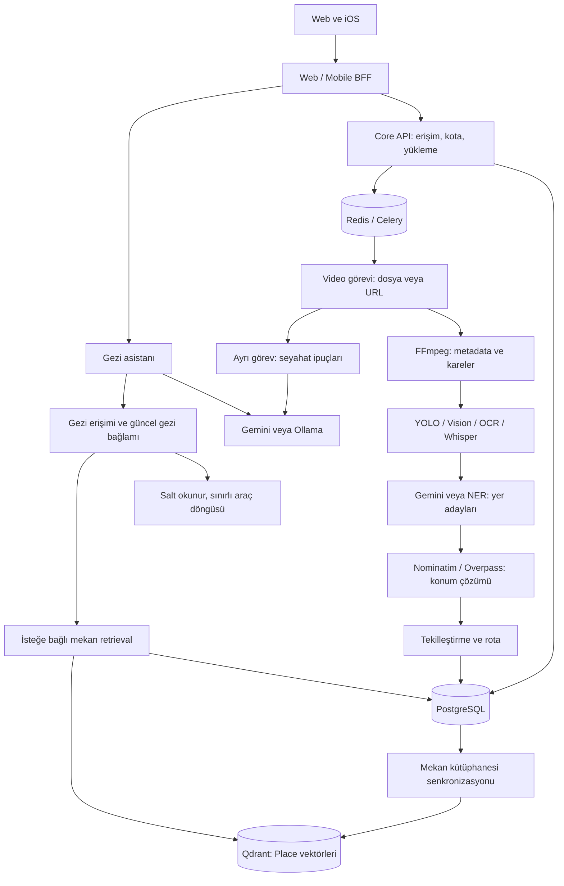

# Analiz, AI ve RAG mimari incelemesi

Tarih: 1 Ekim 2026. Kapsam: kod ve izole regresyon testleri. Gerçek video/model doğruluğu, dış servis gecikmeleri ve üretim yükü bu incelemede ölçülmedi.

Bu belge ilk inceleme anını kaydeder. Sonraki uygulamalar ve güncel kalan işler için [AI toparlanma ve kaynaklı RAG notları](ai-reliability-and-rag.md) okunmalıdır.

## Mevcut akış

Rota optimizasyonu ayrıca deterministik stratejiler kullanır; LLM koordinat veya uygulanmış rota için doğruluk kaynağı değildir. Gemini'nin çıkardığı yer adları coğrafi servislerle çözümlenir. PostgreSQL gerçek mekan ve gezi kayıtlarının kaynağıdır; Qdrant türetilmiş bir arama indeksidir.

## Bu incelemede düzeltilenler

1. **Yüklenen dosyanın yolu kayboluyordu.** `process_video_task` girişteki `video_path` değerini `None` yapıyordu. Yol artık işlemciye korunarak iletiliyor. Yüklenen kalıcı dosya bu görevin sonunda silinmiyor; yeniden denemede ve depolama yaşam döngüsünde kullanılabiliyor.
2. **Opsiyonel ipucu görevi ana analizi yeniden çalıştırabiliyordu.** İpucu kuyruğuna gönderim hata verdiğinde tamamlanmış analiz tekrar deneniyordu. Kuyruk hatası artık tamamlanmış sonucu bozmaz. Celery yeniden tesliminde tamamlanmış videonun AI analizi atlanır; silinmiş video da işlenmez. Bu kontrol, eşzamanlı iki aktif görevi kilitlemez.
3. **URL indirmeleri temizlenmiyordu.** Geçici URL dosyasının temizliği doğru göreve taşındı; indirme başlamadan hata çıkması da güvenli.
4. **SQL commit öncesi Qdrant yazımı vardı.** Yeni/zenginleşen mekanlar artık SQL commit başarılı olduktan sonra indekslenir. Başarısız commit hayalet vektör oluşturmaz; indeks hatası kaydedilmiş mekanları geçersiz kılmaz.
5. **Embedding modeli her repository örneğinde yeniden yükleniyordu.** Model süreç başına paylaşılır; eşzamanlı ilk yükleme kilitlenir. `sentence_transformers` import'u da isteğe bağlı arama/yazma yoluna taşındı. ML'nin yerel bağımlılığı bozuk olduğunda HTTP API açılabilir ve semantik özellik fallback kullanabilir.
6. **İpucu sınıfının adı yanıltıcıydı.** `RAGService` kendi içinde retrieval yapmıyor; Ollama üretim adaptörü. Gerçek retrieval asistan katmanında. Sözleşme bozulmadan bu ayrım belgelendi. Özet prompt'undaki sabit Türkiye varsayımı kaldırıldı.
7. **Başarısız mekan senkronizasyonu SQL oturumunu bozabiliyordu.** Opsiyonel senkronizasyon hatasında rollback eklenerek sonraki push/analytics okumaları için oturum temizlenir. Önceki işlemde kaydedilmiş tamamlanmış video korunur.

## Öncelik sırasına göre kalan mimari işler

### 1. İşlem yaşam döngüsünü kalıcı ve atomik hale getir

Tamamlanmış kayıt kontrolü yeniden teslimi azaltır; iki worker aynı videoyu eşzamanlı çalıştırırsa tek başına yeterli değildir. SQL'de atomik claim/lease ve görev kimliği eklenmeli. Ana sonuç commit'inden sonra kuyruk bildirimi kaybolabilir: ipucu ve indeks güncellemeleri için transactional outbox, sınırlı retry ve yeniden indeksleme görevi gerekir. Mevcut post-commit indeksleme tutarlı veri yayınlar ama Qdrant kesintisinde kayıtların daha sonra otomatik tamamlanmasını garanti etmez.

### 2. Pipeline bütçesini gerçek bir süre/maliyet sınırına bağla

`future.result(timeout=...)` çalışan thread'i durdurmaz. `ThreadPoolExecutor` bağlamından çıkış da çalışan işleri bekler. Bu nedenle aşama timeout'ları toplam pipeline süresini garanti etmiyor. İşlem izolasyonu, tüm akış için ortak deadline ve dış çağrılara kalan bütçenin aktarılması gerekir. Celery soft/hard limitlerinin seçilen worker pool'unda gerçekten uygulandığı doğrulanmalı. İpucu görevi aynı kuyrukta olduğundan yoğunlukta yeni analizleri bekletebilir; ayrı worker/queue ancak kapasite planıyla eklenmeli.

### 3. Pipeline bağımlılıklarını mod ve aşama bazında ayır

`VideoProcessingService.__init__` klasik ML modüllerini tek import bloğunda yükler. Tek eksik paket `_ml_available=False` yaparak Gemini modunu da kapatabilir. Kurucu ayrıca saf Gemini modunda da YOLO/OCR servislerini hazırlar ve bu aşamalar çalışır; mevcut davranış "tek Gemini çağrısı klasik aşamaların hepsini değiştirir" şeklinde anlatılmamalı. Aşama bağımlılıkları bağımsız kurulmalı; saf Gemini/hybrid/klasik modların süre, doğruluk ve maliyeti karşılaştırılmalı.

### 4. RAG bilgi kapsamını netleştir

Bugünkü Qdrant metni **ad + şehir + kategori**, getirilen içerik **kategori + şehir + adres + varsa açılış saatleri**. Tarihçe, ücret ve doğrulanmış seyahat rehberi içermiyor. Dolayısıyla bu özellik kaynaklı bir seyahat ansiklopedisi sayılmaz. `PlaceKnowledge` belgelerine kaynak URL'si, edinilme zamanı, dil ve içerik sürümü eklenmeli; kaynaklı içerik ingestion ve cevapta kaynak gösterimi kurulmalı. Güncel fiyat/saat bilgisi tarihli kaynak bulunmadan kesin ifade edilmemeli. LLM tarafından üretilmiş ipuçları doğrulanmış bilgi gibi indekse alınmamalı.

### 5. Türkçe retrieval kalitesini ölç

Mevcut model `all-MiniLM-L6-v2`; Türkçe ve farklı dillerdeki yer adları için ölçüm yok. İlgisiz top-k sonuçlarını eleyecek skor eşiği de yok. Etiketli Türkçe sorgu kümesiyle mevcut model ve çok dilli alternatif karşılaştırılmalı; Recall@k, ilgili/ilgisiz sonuç oranı ve cevap dayanağı ölçülmeli. Model değişikliği yeni, sürümlü koleksiyon ve toplu yeniden indeksleme gerektirir; mevcut vektörlerle karıştırılmamalı. Eşik rastgele seçilmemeli.

### 6. Sonuç kalitesi ve gözlemlenebilirlik

Mevcut degradation raporu yararlı, fakat sıfır yer çıkarılması "video gezi içeriği değil" ile "bütün çıkarıcılar başarısız" durumlarını yeterince ayırmıyor. Aşama durumları, doğrulanmış/şüpheli konum sayısı, kaynak türü, model/prompt sürümü, p95 süre ve token/maliyet ölçümleri eklenmeli. Çok şehirli videolarda dominant bölge filtresinin doğru uzak durakları şüpheli işaretleme riski ayrı test edilmeli. Ham video, transkript ve kullanıcı mesajları metrik/loglara taşınmamalı.

## Doğrulama

Yeni regresyon testleri dosya yolunun korunmasını, ipucu broker hatasının analizi bozmamasını, URL dosyası temizliğini, tamamlanmış/silinmiş video yeniden teslimini, commit sonrası indeksleme sırasını ve embedding modelinin paylaşılmasını kapsar. Mevcut pipeline, AI provider, mekan arama, retrieval ve asistan testleriyle birlikte çalıştırılır. Gerçek LLM/Qdrant servisine test çağrısı yapılmaz.

Sonuç: ilgili 11 test dosyasında **198 test geçti**. Diff biçim kontrolü de temiz. Bu sonuç canlı model doğruluğu veya yük testi anlamına gelmez.
